<!-- Header: animated wave banner -->


<!-- Animated typing line -->
<p align="center">
  <a href="https://chrishoee.dev">
    
  </a>
</p>

<p align="center">
  <a href="https://chrishoee.dev"></a>
  <a href="https://www.linkedin.com/in/christopher-h%C3%B8e-3b7924257/"></a>
  <a href="https://stackoverflow.com/users/19820692/christopher-h%c3%b8e"></a>
  <a href="https://www.instagram.com/christopher_hoee/"></a>
  
</p>

---

### 🛰️ About me

```ts
const christopher = {
  location:   "Trondheim, Norway",
  studying:   "M.Sc. Computer Science @ NTNU (2025 – 2028)",
  building:   "Production websites for small businesses @ Hoggorm Design (co-founder)",
  teaching:   "Learning Assistant — Distributed Data, Web Development & Databases",
  recently:   "ML / computer-vision internship @ Kongsberg Defence & Aerospace",
  exploring:  ["AI/ML", "Information retrieval", "Distributed systems"],
  offline:    ["Astronomy 🔭", "Biology 🧬", "Running 🏃"],
};
```

I like understanding how complex systems work — whether that's a star cluster, an anomaly-detection model, or a slow database query — and making the web feel **fast and intentional**.

---

### 🧰 Tech stack

<p align="center">
  <br/>
  <br/>
  
</p>

---

### 🚀 Featured projects

<p align="center">
  <a href="https://github.com/Christio02/exo-worlds"></a>
  <a href="https://github.com/Christio02/portfolio"></a>
  <a href="https://github.com/Christio02/dungeons-and-developers"></a>
  <a href="https://github.com/Christio02/flappy"></a>
</p>

---

### 📊 GitHub stats

<!-- Cards in profile/ are generated by .github/workflows/profile-assets.yml -->
<p align="center">
  
  
</p>

<p align="center">
  
</p>

---

### 🐍 Contributions, eaten

<p align="center">
  <picture>
    <source media="(prefers-color-scheme: dark)" srcset="https://raw.githubusercontent.com/Christio02/Christio02/output/github-snake-dark.svg" />
    <source media="(prefers-color-scheme: light)" srcset="https://raw.githubusercontent.com/Christio02/Christio02/output/github-snake.svg" />
    
  </picture>
</p>

<!-- Footer wave -->

